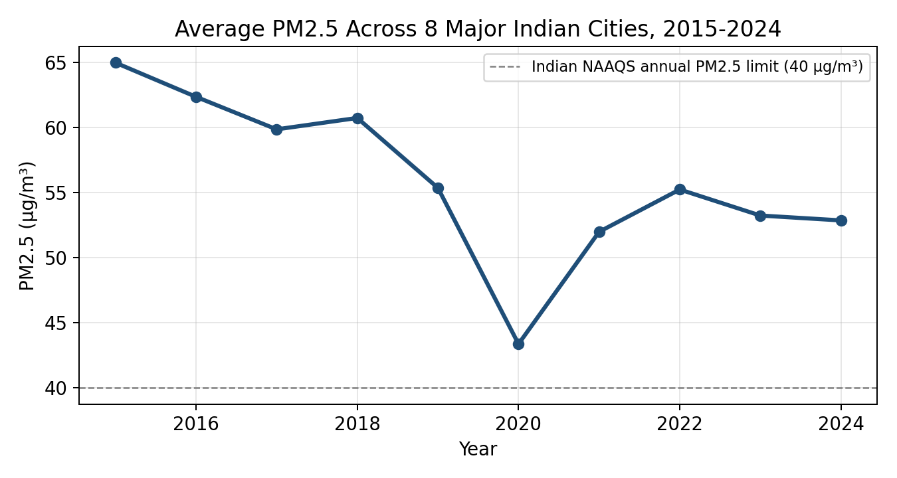

# Air Pollution Trends in Major Indian Cities (2015-2024)

Data analysis project for **Environment & Sustainability**, examining PM2.5, PM10 and AQI trends across 8 major Indian cities (2015-2024) plus a 2024 snapshot of all 28 states and 8 union territories.

**Live dashboard:** open [`dashboard/dashboard.html`](dashboard/dashboard.html) directly in a browser, or enable GitHub Pages (see below) for a shareable link.



## Contents

| Folder | Contents |
|---|---|
| `data/` | `air_quality_india_2015_2024.csv` (8 cities x 10 years) and `state_wise_air_quality_2024.csv` (all states/UTs, 2024) - the data files |
| `excel/` | `Air_Pollution_India_Analysis.xlsx` - the project workbook (pivot-style summaries, formulas, charts) |
| `report/` | `Air_Pollution_India_Project_Report.docx` - the full project report |
| `powerbi/` | `Power_BI_Build_Guide.docx` - step-by-step guide + DAX measures to rebuild the dashboard in Power BI Desktop |
| `dashboard/` | `dashboard.html` - a working interactive dashboard (city trends + state snapshot, filters, KPIs, charts) |
| `images/` | Chart images used in the report |

## Scope

- **City-level:** Delhi, Lucknow, Kolkata, Ahmedabad, Mumbai, Hyderabad, Bengaluru, Chennai - annual PM2.5, PM10 and CPCB AQI, 2015-2024.
- **State-level:** all 28 states + 8 UTs - 2024 PM2.5/PM10/AQI snapshot (representative city) plus NCAP non-attainment status.

## Data sources

- Central Pollution Control Board (CPCB) - CAAQM bulletins & National Air Quality Index
- US EPA AirNow - US Embassy/Consulate monitors in India
- IQAir World Air Quality Report (2019, 2023, 2024 editions)
- UrbanEmissions.info - India NCAP city/state archive

Full methodology, including which values are directly reported vs. interpolated between reported anchor years, is documented in the project report (Section 2) and in the `Data_Notes` column of the data files.

## Publish the dashboard for free with GitHub Pages

1. Push this repo to GitHub (see commands below).
2. On GitHub: **Settings -> Pages -> Source -> Deploy from a branch -> `main` / root**.
3. Your dashboard will be live at `https://<username>.github.io/<repo-name>/dashboard/dashboard.html`.

## Pushing this repo to GitHub

```bash
cd air-pollution-india-project
git init
git add .
git commit -m "Initial commit: air pollution trends India project"
git branch -M main
git remote add origin https://github.com/<your-username>/<your-repo-name>.git
git push -u origin main
```
